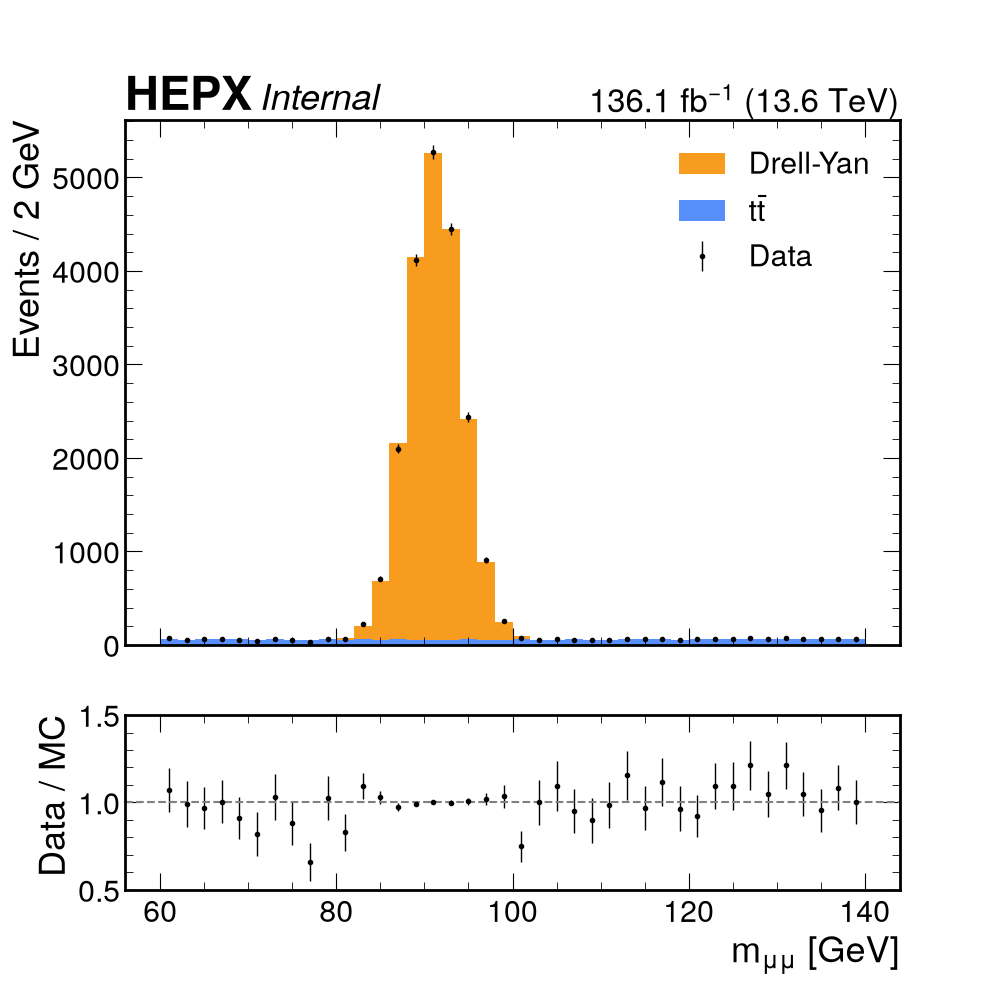

# Skills

## Overview

Questions this chapter answers:

- How do you give a coding agent a procedure it needs only for some tasks, without loading it into every session?
- Which guidance belongs in a skill, and which in `AGENTS.md`?

After working through it you should be able to:

- explain what a skill is and how an agent decides to load one
- decide whether a piece of guidance belongs in `AGENTS.md` or in a skill
- write a `SKILL.md` that follows the specification, with a description that triggers on the right requests
- bundle a helper script with a skill, and test that the skill triggers when it should and gives correct output
- judge whether a skill written by someone else is safe to install

## The procedure you keep retyping

Your `AGENTS.md` tells the agent how to run the tests and what it must never touch. The plots for the analysis note need more: the experiment label with the right status, the luminosity and energy for the years shown, units on every axis, a ratio panel, a PDF for the note and a PNG for the slides. Written out properly that is forty lines, needed twice a week. In `AGENTS.md` they ride along in every session, including the one where you asked the agent to fix a unit test. Leave them out and you retype them, or forget, and the plot comes back labelled "Preliminary" although nobody approved it.

A skill is the place for a procedure like this. Skills follow an open format, Agent Skills, which Anthropic developed and released as a standard. Claude Code, Codex, GitHub Copilot, Cursor, OpenCode and many other agents now support it, and the reference is [agentskills.io](https://agentskills.io).

To see what happens without one, we took the toy repository used later in this chapter, with the plot configuration in place but not the plotting skill, and in October 2026 asked three fresh Claude Code sessions: "Make the publication plot of the dimuon mass for 2023 and 2024." Each session wrote its own plotting script of about 120 lines, in 32 to 40 turns; in two earlier runs with the skill below installed, the same request took 9 and 12. All three took the luminosity from the configuration and got it right. All three also left the status off the label, reasoning that a publication plot is final, so the plot looks approved. One put √N error bars on the data where the other two used Poisson intervals, and the colours and legend layout changed from session to session. Each session did load a skill, Claude Code's built-in one for charts in general, but nothing told it the conventions of the analysis.

## What a skill is

A skill is a folder containing a file called `SKILL.md`. The file starts with YAML frontmatter holding at least a `name` and a `description`, and the rest is Markdown instructions. The folder can also hold whatever those instructions need. The specification suggests `scripts/` for code the agent runs, `references/` for longer documents it reads only when needed, and `assets/` for templates, style files and lookup tables:

```text
publication-plots/
├── SKILL.md
├── scripts/
│   └── plot_stack.py
├── references/
└── assets/
```

Only `SKILL.md` is required. What goes in it is procedural knowledge: what an experienced colleague knows about doing one particular task in your group, written down once with the tools it needs, for the agent to load when a task calls for it.

## Skills and AGENTS.md

[`AGENTS.md`](01-agents-md.md) and a skill are both Markdown for the agent, read at different times. `AGENTS.md` is loaded at the start of every session and describes the project: how to test it, what is off-limits. A skill is loaded only when a task matches it, and describes how to do that one task.

That gives you a test for any line you are about to write down. If it must hold in every session, whatever the task, it goes in `AGENTS.md`. If it matters only for one kind of task, and especially if it runs to more than a few lines, make it a skill in the repository. If you want it in every repository you work in, make it a skill in your home directory.

| Guidance | Where it goes |
| --- | --- |
| `data/` is read-only | `AGENTS.md` |
| The test command, and how long it takes | `AGENTS.md` |
| The ntuples store momenta in MeV | `AGENTS.md` |
| How to make the data/MC plots for the note | Skill in the repository |
| The cutflow table in the note's format | Skill in the repository |
| Your way of writing up a debugging session, in every project | Skill in your home directory |

A rule that must never be broken stays in `AGENTS.md`, even when a skill repeats it. The plotting skill below says never to show data in a blinded signal region. If the agent doesn't load the skill, that sentence isn't there, so the rule goes in the root `AGENTS.md` too.

## How skills are loaded

The standard calls its loading scheme progressive disclosure. It has three stages.

Discovery happens when a session starts. The agent finds the installed skills and reads only their frontmatter, so each skill adds a name and a description to its context, roughly 50 to 100 tokens.

Activation happens when your request matches a description, and the agent reads that skill's whole `SKILL.md`. In most tools the model makes this decision itself; there is no keyword matching. You can also activate a skill by name, for example `/publication-plots` in Claude Code or `$publication-plots` in Codex.

In execution the agent follows the instructions and opens the other files only when it reaches them: it runs `scripts/plot_stack.py` at the step that says so, and reads a file in `references/` only if told to.

So thirty installed skills cost thirty descriptions, a few thousand tokens, in each session, and their bodies cost nothing until used. Pasted into `AGENTS.md`, the same thirty procedures would cost all of their text on every turn. The specification recommends keeping the body of `SKILL.md` under 500 lines and about 5000 tokens, with longer material in `references/`.

The catalogue has a budget, though: Codex gives it 2% of the context window and shortens descriptions when it overflows, and Claude Code gives it 1% and drops the descriptions of the skills you use least. Put the main use case first in the description. Loaded skills stay in the conversation without being reread, and when Claude Code compacts a long conversation it keeps only the first 5000 tokens of each, so the important instructions go near the top.

## The SKILL.md format

The [specification](https://agentskills.io/specification) is short. The frontmatter has two required fields and four optional ones:

| Field | Required | Rules |
| --- | --- | --- |
| `name` | Yes | 1 to 64 characters, lowercase letters, digits and hyphens only, with no hyphen at either end and none doubled. Must match the folder name. |
| `description` | Yes | 1 to 1024 characters: what the skill does and when to use it. |
| `license` | No | A licence name, or the name of a bundled licence file. |
| `compatibility` | No | Up to 500 characters on what the skill needs, such as system packages or network access. Rarely needed. |
| `metadata` | No | A map of string keys to string values, for anything else. |
| `allowed-tools` | No | Experimental: tools the skill may use without asking, separated by spaces. Support varies. |

So `publication-plots` is a valid name, while `Publication-Plots`, `-plots` and `publication--plots` are not, and neither is `publication-plots` in a folder called `plots`.

The body has no required structure; the specification suggests steps, examples of input and output, and edge cases. Refer to other files by paths relative to the skill folder, one level deep, so the agent doesn't have to follow a chain of documents.

YAML is where most broken skills break. `metadata` values must be strings, so write `version: "1.0"` with quotes. A one-line description containing a colon, such as `description: Use when: the user asks for plots`, is invalid YAML. Claude Code then loads the body with empty metadata: the skill runs when called by name but never triggers on its own, and nothing tells you why. Use a block scalar (`description: >-` and indented lines) for anything longer than a phrase. The reference validator [skills-ref](https://github.com/agentskills/agentskills/tree/main/skills-ref), a demonstration library, catches both mistakes and the naming errors above with `skills-ref validate path/to/skill`.

Many tools accept more than the specification and add fields of their own. Claude Code treats `name` as optional and understands `disable-model-invocation` and `paths`, which other tools ignore. Stick to the specification unless your whole group uses one tool.

## Writing the description

Before it loads a skill, the model sees only the name and description, so the description is what makes the skill trigger. There are two ways to get it wrong.

Too vague, and the skill never fires:

```yaml
description: Plotting helper.
```

Ask for "the dimuon mass plot for Thursday's meeting" and nothing links the request to "plotting helper", so the agent writes its own matplotlib code. You get a plot with no experiment label and no hint that a skill existed.

Too broad, and it fires on everything:

```yaml
description: Use for any analysis, Python or physics task in this repository.
```

Now the plotting instructions load when you ask the agent to fix a failing unit test. That wastes forty lines of context, and the agent may follow them: it makes a plot nobody asked for, or won't touch a test that draws a histogram because the skill says never to write new plotting code.

The description in the worked example below names the task in the words people use for it, and says when to use it and where it stops:

```yaml
description: >-
  Make publication-style histogram plots for this analysis with hist and
  mplhep, with stacked simulation, data points, a ratio panel and the
  experiment label with luminosity and energy. Use when the user asks for a
  plot or figure for a talk, the analysis note or a paper, or wants an
  existing plot cleaned up for approval, even if they do not mention mplhep.
  Not for quick exploratory plots in a notebook, and not for fits.
```

The agentskills.io [guide to descriptions](https://agentskills.io/skill-creation/optimizing-descriptions) also recommends phrasing it as an instruction ("Use when...") and describing what the user wants rather than how the skill works.

Even a good description won't trigger on every matching request. Agents tend to skip skills for tasks they think they can manage alone, so "plot `data_mll`" is more likely to bypass the skill than "make the dimuon mass plot for the note". If a task must go through the skill, call it by name.

Test the description like code: a dozen prompts, half that should trigger the skill and half that shouldn't. The useful negatives are near-misses that share words with the skill but need something else, such as "fit the Z peak in `data_mll`". Run each prompt in a fresh session, more than once since the model is not deterministic, and count. The guide also suggests holding some prompts back, so that you don't tune the wording to the ones you tested.

## Where skills live

The specification says what goes inside a skill folder, not where the folder goes, so each tool has its own search paths. Most look in a project directory inside the repository, for skills that travel with the code, and a user directory in your home, for skills you want everywhere.

| Tool | Project skills | User skills |
| --- | --- | --- |
| [Claude Code](https://code.claude.com/docs/en/skills) | `.claude/skills/<name>/` | `~/.claude/skills/<name>/` |
| [Codex](https://learn.chatgpt.com/docs/build-skills) | `.agents/skills/<name>/`, in every directory from where you start it up to the repository root | `~/.agents/skills/<name>/` |
| [OpenCode](https://opencode.ai/docs/skills/) | `.opencode/skills/`, `.claude/skills/` or `.agents/skills/` | `~/.config/opencode/skills/`, `~/.claude/skills/` or `~/.agents/skills/` |

`.agents/skills/` is becoming the shared location: Codex, OpenCode and VS Code all read it. As of October 2026, [Claude Code's documentation](https://code.claude.com/docs/en/skills) lists only `.claude/skills/`, and in our tests that month Claude Code did not find skills in `.agents/skills/` until we added the symlink below. If your group mixes Claude Code with another agent, keep one copy in `.agents/skills/` and link to it:

```bash
mkdir -p .claude/skills
ln -s ../../.agents/skills/publication-plots .claude/skills/publication-plots
```

Claude Code follows symlinked skill folders, but remember the Windows problem from the AGENTS.md chapter: without `core.symlinks`, the link is checked out as a small text file.

When two skills share a name, the tools disagree about which wins: Claude Code prefers your personal one over the project's, while Codex lists both. Give your skills distinct names.

We checked these paths against each tool's documentation in October 2026, and they change from release to release. The [client list on agentskills.io](https://agentskills.io/clients) links to the current skills page of each supported tool.

## A worked example: publication plots

Plotting came up again and again in the HSF community survey on AI-assisted coding, and it suits a skill well: the conventions are fiddly, and a mistake usually shows only when someone reads the plot closely.

Here is a failure you can expect without one. You ask for the dimuon mass plot with the 2023 data. The agent finds an older plotting script, or an example earlier in the conversation, with `lumi=108.9` in the label call, and reuses it. The plot says 108.9 fb⁻¹ over 27.2 fb⁻¹ worth of data. Nothing fails, the plot looks fine, and the mistake is caught by a reviewer of the note, if at all.

The skill below belongs to the made-up dimuon analysis from the AGENTS.md chapter, which gains a plot configuration and the skill folder:

```text
dimuon-analysis/
├── AGENTS.md
├── config/
│   ├── selection.yaml
│   └── plot_config.json
├── results/
│   └── histograms.root        # written by scripts/make_histograms.py
├── scripts/
└── .agents/skills/publication-plots/
    ├── SKILL.md
    └── scripts/
        └── plot_stack.py
```

The configuration holds what is a fact about the analysis rather than a matter of style. The numbers are made up:

```json
{
  "experiment": "HEPX",
  "style": "ROOT",
  "blinded_prefixes": ["sr_"],
  "years": {
    "2018": {"lumi_fb": 58.3, "com_tev": 13.0},
    "2023": {"lumi_fb": 27.2, "com_tev": 13.6},
    "2024": {"lumi_fb": 108.9, "com_tev": 13.6}
  }
}
```

### SKILL.md

````markdown
---
name: publication-plots
description: >-
  Make publication-style histogram plots for this analysis with hist and
  mplhep, with stacked simulation, data points, a ratio panel and the
  experiment label with luminosity and energy. Use when the user asks for a
  plot or figure for a talk, the analysis note or a paper, or wants an
  existing plot cleaned up for approval, even if they do not mention mplhep.
  Not for quick exploratory plots in a notebook, and not for fits.
compatibility: Python 3.10+ with hist, mplhep 1.3+, uproot and matplotlib
metadata:
  version: "1.0"
---

# Publication plots

Make every data/MC comparison with `scripts/plot_stack.py` in this skill's
folder. Do not write new plotting code for these plots. If the script lacks
an option you need, say so and propose a change to the script.

## Steps

Run the commands from the repository root, so that `config/` and `results/`
resolve. `scripts/` in the commands is the folder in this skill, not the
repository's `scripts/`.

1. List the histograms:
   `python scripts/plot_stack.py results/histograms.root --list`
2. Make the plot. Pass the MC samples smallest first; the first is drawn at
   the bottom of the stack.

   ```bash
   python scripts/plot_stack.py results/histograms.root --data data_mll \
     --mc ttbar_mll:'$t\bar{t}$' --mc dy_mll:Drell-Yan \
     --year 2023 --year 2024 --xlabel '$m_{\mu\mu}$ [GeV]' \
     --output plots/mll
   ```

3. Open the PNG and go through the checklist below.
4. Report the files and the JSON line the script printed.

## Rules

- The luminosity and energy come from `config/plot_config.json` through
  `--year`. Never type a luminosity and never copy one from another plot.
- Use `--status internal` unless the user says the plot has been approved.
- Histograms whose names start with `sr_` are blinded. Never pass
  `--unblind` unless the user says the analysis has been unblinded.
- Axis labels give units in square brackets, as in `$p_{T}$ [GeV]`.

## Gotchas

- The histograms are already scaled to the luminosity of their year. Do not
  scale them again.
- 2018 data was taken at 13 TeV, later years at 13.6 TeV. The script will
  not combine them; make one plot per energy.
- Put labels containing `$` in single quotes. In double quotes the shell
  expands `$m_` to nothing and the label silently loses its variable.

## Before you report

- [ ] The label shows the requested years and the right status.
- [ ] Every axis label has a unit where one applies.
- [ ] No data is shown in a blinded region.
- [ ] All ratio points lie between 0.5 and 1.5. If not, say so instead of
      changing the range.
````

The name matches the folder and the description is the one discussed above. `compatibility` is there because a fresh environment may lack the packages, and `metadata.version` is quoted.

The first paragraph matters most. The conventions live in a script, which draws the plot the same way every time, and the prose tells the agent to use it instead of improvising. Left to itself, an agent writes new matplotlib code for each plot, and each version comes out a little different.

Each rule answers a specific failure. The luminosity rule is the story above, the status rule keeps "Preliminary" off plots nobody has approved, and the blinding rule is repeated in the script and in `AGENTS.md`.

The gotchas are mistakes the agent would make while acting sensibly. Weighted simulation looks as if it still needs scaling to the luminosity, and combining years looks harmless. The quoting one is easy to miss: with `--xlabel "$m_{\mu\mu}$ [GeV]"` in double quotes, the shell replaces `$m_` with an empty string, Python receives `{\mu\mu}$ [GeV]`, and the plot goes out with that as its axis label and no error.

The checklist makes the agent look at its own output before it reports, and gives you a list to check its report against.

### scripts/plot_stack.py

```python
#!/usr/bin/env python3
# /// script
# requires-python = ">=3.10"
# dependencies = ["hist", "mplhep>=1.3", "uproot", "matplotlib", "numpy"]
# ///
"""Stacked data/MC plot with a ratio panel, in the analysis style.

The experiment name, luminosity and centre-of-mass energy come from the
plot config, never from the command line. On success prints one JSON line
to stdout; on failure prints the reason to stderr and exits with code 2.
"""

import argparse
import json
import re
import sys
from pathlib import Path

import matplotlib

matplotlib.use("Agg")
import matplotlib.pyplot as plt
import mplhep as hep
import numpy as np
import uproot

STATUS = {"internal": "Internal", "preliminary": "Preliminary", "final": ""}


def fail(message):
    print(f"error: {message}", file=sys.stderr)
    sys.exit(2)


def get_args():
    p = argparse.ArgumentParser(description=__doc__,
                                formatter_class=argparse.RawDescriptionHelpFormatter)
    p.add_argument("input", help="ROOT file with TH1 histograms")
    p.add_argument("--list", action="store_true", help="list the TH1s in INPUT and exit")
    p.add_argument("--data", help="data histogram; leave out for a simulation-only plot")
    p.add_argument("--mc", action="append", default=[], metavar="NAME:LABEL",
                   help="MC histogram and legend label; repeat, first is drawn at the bottom")
    p.add_argument("--year", action="append", default=[],
                   help="data-taking year from the config; repeat to combine years")
    p.add_argument("--xlabel", default="")
    p.add_argument("--status", choices=STATUS, default="internal")
    p.add_argument("--logy", action="store_true")
    p.add_argument("--unblind", action="store_true", help="allow data in a blinded region")
    p.add_argument("--config", default="config/plot_config.json")
    p.add_argument("--output", help="output path without extension; writes .pdf and .png")
    return p.parse_args()


def read(file, name):
    if name not in file:
        fail(f"no histogram '{name}' in {file.file_path}; use --list to see what is there")
    return file[name].to_hist()


def lumi_and_energy(config, years):
    known = config["years"]
    if not years:
        fail(f"--year is required; years in the config: {', '.join(known)}")
    missing = [y for y in years if y not in known]
    if missing:
        fail(f"year {', '.join(missing)} not in the config; known: {', '.join(known)}")
    energies = {known[y]["com_tev"] for y in years}
    if len(energies) > 1:
        fail(f"years {', '.join(years)} have different energies; make one plot per energy")
    return sum(known[y]["lumi_fb"] for y in years), energies.pop()


def y_label(edges, xlabel):
    widths = np.diff(edges)
    if not np.allclose(widths, widths[0]):
        return "Events / bin"
    unit = re.search(r"\[(.+)\]", xlabel)
    return f"Events / {widths[0]:g}" + (f" {unit.group(1)}" if unit else "")


def main():
    args = get_args()
    with uproot.open(args.input) as f:
        if args.list:
            print(json.dumps([k for k, c in f.classnames(cycle=False).items() if c.startswith("TH1")]))
            return
        if not args.mc or not args.output:
            fail("--mc and --output are required")
        if not Path(args.config).exists():
            fail(f"{args.config} not found; run from the repository root or pass --config")
        config = json.loads(Path(args.config).read_text())
        years = sorted(set(args.year))
        lumi, com = lumi_and_energy(config, years)
        if args.data and args.data.startswith(tuple(config["blinded_prefixes"])) and not args.unblind:
            fail(f"'{args.data}' is in a blinded region; ask before using --unblind")
        specs = [m.split(":", 1) if ":" in m else (m, m) for m in args.mc]
        mc = [read(f, name) for name, _ in specs]
        data = read(f, args.data) if args.data else None

    hep.style.use(config["style"])
    if data is None:
        fig, ax = plt.subplots()
        bottom = ax
    else:
        fig, (ax, bottom) = plt.subplots(2, 1, sharex=True, height_ratios=(3, 1))
    hep.histplot(mc, ax=ax, stack=True, histtype="fill", label=[label for _, label in specs])
    total = sum(mc[1:], start=mc[0])
    edges = total.axes[0].edges

    if data is not None:
        counts = data.values()
        hep.histplot(counts, bins=edges, yerr=np.sqrt(counts), ax=ax, histtype="errorbar",
                     color="black", label="Data")
        expected = total.values()
        valid = expected > 0
        ratio = np.divide(counts, expected, out=np.full_like(expected, np.nan), where=valid)
        error = np.divide(np.sqrt(counts), expected, out=np.full_like(expected, np.nan), where=valid)
        hep.histplot(ratio, bins=edges, yerr=error, ax=bottom, histtype="errorbar", color="black")
        bottom.axhline(1, color="grey", linestyle="--")
        bottom.set_ylim(0.5, 1.5)
        bottom.set_ylabel("Data / MC")
        ax.set_xlabel("")

    bottom.set_xlabel(args.xlabel)
    ax.set_ylabel(y_label(edges, args.xlabel))
    if args.logy:
        lowest = mc[0].values()
        ax.set_yscale("log")
        ax.set_ylim(bottom=0.5 * lowest[lowest > 0].min())
    ax.legend()
    hep.label.exp_label(exp=config["experiment"], text=STATUS[args.status], data=data is not None,
                        lumi=lumi, lumi_format="{0:.1f}", com=com, ax=ax)

    out = Path(args.output)
    out.parent.mkdir(parents=True, exist_ok=True)
    files = [str(out.with_suffix(suffix)) for suffix in (".pdf", ".png")]
    for name in files:
        fig.savefig(name)
    print(json.dumps({
        "files": files, "years": years, "lumi_fb": lumi, "com_tev": com, "status": args.status,
        "mc_total": float(total.values().sum()),
        "data_total": None if data is None else float(data.values().sum()),
    }))


if __name__ == "__main__":
    main()
```

The script is written to be run by an agent. It never waits for input, `--help` documents every option, errors go to stderr with a hint about what to do next, and the result is one line of JSON on stdout that the agent can quote in its report. Agents may still read a bundled script in full before running it, as Claude Code did in most of our test runs, so keep scripts short and give them a clear `--help`.

The checks do what prose can't. The luminosity is looked up in the configuration and summed over the requested years, and asking for `--year 2024` twice does not double it. Years taken at different energies are refused, and so is a data histogram in a blinded region unless `--unblind` is given. Each refusal exits with code 2, which an agent notices, whereas a wrong label goes unnoticed.

The error bars are √N, which is fine for these counts; bins with a handful of events would need Poisson intervals. The comment block at the top declares the dependencies in [PEP 723](https://peps.python.org/pep-0723/) format, so `uv run` can build an environment for the script, though in the repository you would normally use the analysis environment.

We produced the figure below with `plot_stack.py`, running the command from step 2 on the toy histograms created under "Trying it":



### Trying it

You can try the skill in the `toy-dimuon/` repository from the [AGENTS.md exercise](01-agents-md.md). Put the skill folder in `.agents/skills/publication-plots/`, with the `.claude/skills/` link if you use Claude Code, and save the configuration above as `config/plot_config.json`. Then create the toy histograms from the repository root, with its environment active:

```bash
pip install matplotlib mplhep   # plot_stack.py needs these too
cat > make_histograms.py <<'EOF'
"""Write toy data/MC histograms to results/histograms.root.

They stand for 2023 and 2024 combined. Nothing in the file records which
years it holds, so whoever makes a plot has to know it.
"""
from pathlib import Path

import hist
import numpy as np
import uproot

rng = np.random.default_rng(1)


def mll(values, weight):
    h = hist.Hist.new.Reg(40, 60, 140, name="mll").Weight()
    h.fill(values, weight=weight)
    return h


dy = mll(rng.normal(91.2, 3.0, 40_000), 0.5)
ttbar = mll(rng.uniform(60, 140, 8_000), 0.3)
data = hist.Hist.new.Reg(40, 60, 140, name="mll").Double()
data[...] = rng.poisson(dy.values() + ttbar.values())
Path("results").mkdir(exist_ok=True)
with uproot.recreate("results/histograms.root") as f:
    f["dy_mll"] = dy
    f["ttbar_mll"] = ttbar
    f["data_mll"] = data
EOF
python make_histograms.py
```

Nothing in `histograms.root` itself says which years it holds. You have to know that it stands for 2023 and 2024 and pass both years; the script cannot check.

In a new session, ask for "the dimuon mass plot with the 2023 and 2024 data for the note". The transcript should show the skill loading and one call to `plot_stack.py` with both years, and the label should read 136.1 fb⁻¹ (13.6 TeV). Then ask for the same plot with 2018 added, and check that the agent reports the script's refusal instead of working around it.

When we asked Claude Code for 2018 and 2024 together in October 2026, and told it to run the script anyway, the script refused with exit code 2 both times and the agent passed the refusal on. In both runs it then offered to plot 2018 alone and 2024 alone from the same file, which holds 2023 and 2024 combined, without checking what the histograms contained. The script cannot catch that; only someone who knows the file can.

## A second example: checking against a reference

Any procedure with fixed steps and a fixed way of judging the result is a candidate. One that pays off quickly compares a new set of histograms with a reference file after a change that should not move any physics, such as a refactoring or a speed-up:

```yaml
---
name: compare-to-reference
description: >-
  Check whether the analysis histograms still agree with the reference file
  after a code change. Use when the user asks whether a change altered the
  physics output, wants a regression check before merging, or reports that
  yields or shapes have moved. Not for comparing data with simulation.
---
```

The body would have the agent run the pipeline on the small test file, then a bundled `scripts/compare.py` that compares each histogram with `tests/data/reference.root`, bin by bin in units of the uncertainty, and lists those beyond tolerance. Most of the value is in one rule: never update the reference file or the tolerance to make the comparison pass. That is the failure from the AGENTS.md chapter, where the agent loosened a tolerance to get a green test. The rule is in `AGENTS.md` already, and the skill repeats it where the agent is most likely to break it.

Documenting an old module nobody maintains, say a Fortran routine inside the reconstruction, is another good candidate: which files to read, what to record (inputs, outputs, units, global state), and no code changes along the way.

## Existing skills

Collaborations have started writing their own skills. The notes from the HSF LLMs for HEP hackathon, 28 September 2026, list ["Skills for Mu2e"](https://github.com/Mu2e/aitools) among the training material that already exists. It is a public repository with skills for building the Mu2e offline software, editing FHiCL configuration, finding data with SAM or metacat and reviewing pull requests, and most of them use `compatibility` and a quoted `metadata.version` in their frontmatter, as in the example above.

General collections such as [anthropics/skills](https://github.com/anthropics/skills) and [openai/skills](https://github.com/openai/skills) are worth reading for their structure before you write your own, even if none of their skills fits your work. Read the section on pitfalls below before installing any of them, or anything a colleague sends you.

## Exercise

Write a skill for a small analysis task, then check that it loads on a matching request and not on an unrelated one, and that its numbers are right.

1. Use the `toy-dimuon/` repository from the [AGENTS.md exercise](01-agents-md.md). If you don't have it, the setup script is in that chapter's "Toy repository" dropdown.
2. Write a skill called `cutflow` that reports the cutflow of the selection in `dimuon.py` as a Markdown table with the columns Step, Events and Efficiency, and these steps:

   - All events
   - At least 2 muons
   - At least 2 muons with pT > 20 GeV
   - Opposite-charge pair

   The efficiency of each step is relative to the one before. Put the skill in `.agents/skills/cutflow/`, or in `.claude/skills/cutflow/` for Claude Code. Whether you bundle a script is up to you.
3. Start your agent in the repository and check that it lists the skill (`/skills` in most tools). If it doesn't, check the folder name, the file name (`SKILL.md`, in capitals) and the frontmatter.
4. In a fresh session, give it this prompt word for word:

   > How many events survive each step of the dimuon selection? I need the numbers for a slide.

   In the transcript, look for the skill being loaded: a call to a skill tool, or the agent reading your `SKILL.md`.
5. In another fresh session, give it a request that shares words with the skill but needs something else:

   > Make the pT threshold in select_pairs a command-line option of run.py.

   The skill should not load.
6. Check the numbers from step 4 against an independent count that does not use `select_pairs`:

   ```bash
   python -c '
   import awkward as ak, uproot
   a = uproot.open("data/events.root")["Events"].arrays(["Muon_pt", "Muon_charge"])
   good = a.Muon_pt > 20
   plus = ak.sum(good & (a.Muon_charge > 0), axis=1)
   minus = ak.sum(good & (a.Muon_charge < 0), axis=1)
   print(len(a), ak.sum(ak.num(a.Muon_pt) >= 2), ak.sum(plus + minus >= 2), ak.sum((plus > 0) & (minus > 0)))
   '
   ```

   The four numbers should match the Events column exactly.

Run steps 4 and 5 at least twice each; a skill that loads in one run out of two needs a better description. The agentskills.io guide to [evaluating skills](https://agentskills.io/skill-creation/evaluating-skills) describes a more thorough method that compares runs with and without the skill.

<details>
<summary>Solution</summary>

A short skill with a script, so that the numbers come from code rather than from the model:

```text
.agents/skills/cutflow/
├── SKILL.md
└── scripts/
    └── cutflow.py
```

````markdown
---
name: cutflow
description: >-
  Produce the cutflow of the dimuon selection as a Markdown table, with the
  number of events after each cut and the efficiency of each step. Use when
  the user asks how many events pass each cut, for selection efficiencies,
  or for cutflow numbers for slides or a note. Not for changing the
  selection itself.
---

# Cutflow

Run the command from the repository root, so that `dimuon.py` and `data/`
resolve. `scripts/` in the command is the folder in this skill, not the
repository's `scripts/`.

```bash
python scripts/cutflow.py data/events.root
```

Copy the table it prints into your answer unchanged. Do not compute the
numbers another way and do not round them.

If the user asks for a different pT threshold, add `--pt-min VALUE` (in GeV)
and say which threshold you used. For any other change to the selection,
ask first: this skill only reports numbers.
````

```python
"""Print the cutflow of the dimuon selection as a Markdown table."""

import argparse
import sys
from pathlib import Path

import awkward as ak

sys.path.insert(0, str(Path.cwd()))  # dimuon.py lives in the repository root
from dimuon import load_muons, select_pairs  # noqa: E402

parser = argparse.ArgumentParser(description=__doc__)
parser.add_argument("input", help="ROOT file, e.g. data/events.root")
parser.add_argument("--pt-min", type=float, default=20.0, help="muon pT threshold in GeV")
args = parser.parse_args()

muons = load_muons(args.input)
good = muons[muons.pt > args.pt_min]
steps = [
    ("All events", len(muons)),
    ("At least 2 muons", ak.sum(ak.num(muons) >= 2)),
    (f"At least 2 muons with pT > {args.pt_min:g} GeV", ak.sum(ak.num(good) >= 2)),
    ("Opposite-charge pair", ak.sum(ak.num(select_pairs(muons, args.pt_min)) > 0)),
]

print("| Step | Events | Efficiency |")
print("| --- | ---: | ---: |")
previous = None
for name, n in steps:
    efficiency = "" if previous is None else f"{100 * n / previous:.1f}%"
    print(f"| {name} | {n} | {efficiency} |")
    previous = n
```

Python puts the script's own folder on the import path, not the directory you run it from, so `import dimuon` would fail without the `sys.path` line. The script reuses `load_muons` and `select_pairs` instead of reimplementing the selection, so the cutflow can't drift away from the analysis code. That is also why step 6 counts independently.

On the toy sample the table looks like this. With a different NumPy version your numbers may differ slightly; the independent count is what they must match.

| Step | Events | Efficiency |
| --- | ---: | ---: |
| All events | 50000 |  |
| At least 2 muons | 29679 | 59.4% |
| At least 2 muons with pT > 20 GeV | 13601 | 45.8% |
| Opposite-charge pair | 8044 | 59.1% |

The first prompt is an easy test, since it nearly repeats the description. For a harder one, try "what's the efficiency of the opposite-charge requirement?", which never mentions a cutflow. The second prompt asks to change the selection, which the description rules out in so many words.

If the skill doesn't load in step 4, the agent has probably counted the events itself with a few lines of awkward code, as agents often do for small tasks; name the situation more clearly in the description. If it loads in step 5, the description is too broad. If the numbers are wrong, check whether the agent ran your script at all. If the script disagrees with the independent count, one of the two has a bug, which is what the check is for.

We ran steps 4 and 5 word for word with Claude Code only, in October 2026, three times each, alongside five earlier runs with other prompts, so treat this as an anecdote rather than a rate. The skill loaded in all seven runs that asked for the cutflow, with numbers that matched the independent count, and in none of the four that asked for something else, including step 5, where all three runs added a working `--pt-min` option to `run.py`. The only problem came in the first run, when the agent had to search for the script because the `SKILL.md` did not yet say that `scripts/` meant the skill's own folder; after we fixed that, all six later runs that asked for the cutflow ran the script from the right place first time.

</details>

## Pitfalls and responsible use

A skill can run code. Installing one gives your agent someone else's instructions and scripts, which it will run with your permissions, usually including your grid proxy and your batch account. Install skills only from sources you trust, and read the `SKILL.md` and every script before the first use, as you would a setup script. If you copy one from GitHub, pin the commit and read the diff on each update.

Project skills arrive with a clone: start an agent in a colleague's repository and their skills are in its catalogue. Not every tool asks whether you trust the folder first, and Claude Code's documentation warns that a project skill's `allowed-tools` grant applies in a `-p` run even in a folder you never trusted. Look in `.agents/skills/` and `.claude/skills/` before running an agent in a repository you cloned.

No tokens, passwords or paths to credential files belong in a skill's text or scripts. A project skill is committed, and the text of any skill goes to the model provider when it loads. A script that needs a credential should read it from an environment variable and fail clearly when it is not set.

hist and mplhep change between releases and the luminosity gets updated after a new calibration, so a skill written against the old state goes stale. A wrong skill does more harm than none, because the agent follows it with confidence. Keep project skills in the analysis repository, change them in the same pull request as the code or configuration they describe, and review them like code; a `CODEOWNERS` entry for `.agents/skills/` helps. Numbers that change, like the luminosity, belong in a file the analysis already reads, so that a recalibration is a one-line change in one place.

A skill is guidance, not a guardrail. The agent may not load it at all, and when it does, it can skip a step or lose part of the text when a long conversation is compacted. The blinding check in `plot_stack.py` only helps when the agent runs `plot_stack.py`. Anything that must not happen needs the measures from the AGENTS.md chapter: a sandbox, read-only data and permission settings. For a skill with side effects, such as one that submits jobs, Claude Code's `disable-model-invocation: true` stops the model loading it by itself.

You stay responsible for the output. A skill makes it more likely that the plot has the right label; it does not make the plot right. Check the label and the luminosity yourself before the plot goes into the note, and treat a cutflow produced through a skill like any other numbers: compare it with something you trust.

## Key points

- A skill is a folder with a `SKILL.md`: a `name` and a `description` in the frontmatter, then instructions, optionally with scripts, references and assets.
- `AGENTS.md` is loaded in every session and describes the project; a skill is loaded when a task matches it and describes that task. Rules that must always hold stay in `AGENTS.md`.
- Until a skill is needed the agent sees only its name and description, so the description decides when it triggers. Test it on prompts that should and should not trigger it.
- Put fixed conventions and checks in a bundled script. Search paths differ between tools, and `.agents/skills/` is the most widely read.
- Read skills like code before installing them, keep secrets out, and version them with the analysis. They don't replace a sandbox or your own review of the output.

## References

- [Agent Skills](https://agentskills.io): overview of the standard
- [Specification](https://agentskills.io/specification): the `SKILL.md` format
- [Quickstart](https://agentskills.io/skill-creation/quickstart): a first skill, step by step
- [Best practices for skill creators](https://agentskills.io/skill-creation/best-practices)
- [Optimizing skill descriptions](https://agentskills.io/skill-creation/optimizing-descriptions)
- [Evaluating skill output quality](https://agentskills.io/skill-creation/evaluating-skills)
- [Using scripts in skills](https://agentskills.io/skill-creation/using-scripts)
- [How to add skills support to your agent](https://agentskills.io/client-implementation/adding-skills-support): search paths, name collisions and trust, from the tool author's side
- [Client showcase](https://agentskills.io/clients): tools that support skills, with links to their documentation
- [Extend Claude with skills](https://code.claude.com/docs/en/skills) (Claude Code)
- [Build skills](https://learn.chatgpt.com/docs/build-skills) (Codex)
- [Agent Skills](https://opencode.ai/docs/skills/) (OpenCode)
- [hist](https://hist.readthedocs.io/) and [mplhep](https://mplhep.readthedocs.io/) documentation
